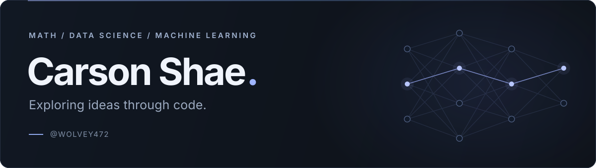

  <picture>
    <source media="(max-width: 600px)" srcset="./assets/header-mobile.svg" />
    
  </picture>

## About Me

I'm **Carson Shae**, a high school student from **North Dakota** with a passion for mathematics, data science, and machine learning. I enjoy programming in Python and exploring the ideas behind intelligent systems.

## Technical Skills

**Languages**

  
  

**Data & Visualization**

  
  
  

**Machine Learning**

  
  
  
  

---

**Let's connect** &nbsp; · &nbsp; [LinkedIn](https://linkedin.com/in/carson-shae-4a759b3b1) &nbsp; / &nbsp; [Email](mailto:carsonkshae@gmail.com) &nbsp; / &nbsp; [Instagram](https://instagram.com/carson.shae.1)
